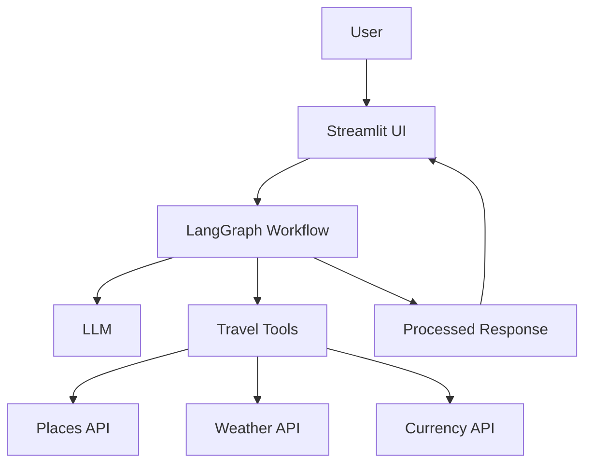

# ✈️ Trip Planner

An AI-powered travel planning application built with **Python**, **LangGraph**, and **Streamlit**. The project aims to help users explore travel destinations, discover places, check weather conditions, convert currencies, and organize estimated trip expenses through an AI-assisted workflow.

> **Project status:** Under development. The README describes the intended initial scope and architecture. Features should be considered available only after they have been implemented and tested.

## Overview

Planning a trip often involves gathering information from several sources. Trip Planner is being developed to bring selected travel-planning tasks into one application.

The application will combine an LLM-driven workflow with external APIs. LangGraph will coordinate the workflow, while separate tool modules will handle API integrations and travel-related operations.

## Planned Features

- **Destination recommendations** based on travel preferences, budget, duration, interests, and travel dates.
- **Places discovery** for attractions, landmarks, nature spots, and other points of interest.
- **Weather information** for a selected destination, subject to the capabilities of the chosen weather API.
- **Currency conversion** using external exchange-rate data.
- **Expense estimation** with categories such as accommodation, food, transportation, activities, and other costs.
- **AI workflow orchestration** using LangGraph to process requests and coordinate relevant operations.

Weather, place details, and exchange rates will depend on the availability and limitations of their respective API providers. Expense calculations are estimates, not confirmed prices.

## Technology Stack

| Technology | Purpose |
|---|---|
| Python | Primary programming language |
| LangGraph | AI workflow orchestration and shared state management |
| LLM provider | Natural-language understanding and response generation |
| External APIs | Places, weather, and exchange-rate information |
| Streamlit | Initial user interface |
| Pytest | Automated testing |
| `python-dotenv` / environment variables | Local configuration and secret management |

Specific LLM and API providers will be selected during implementation based on reliability, API capabilities, free-tier limits, cost, and integration complexity.

## Architecture

The application is organized to keep the user interface, workflow orchestration, and external integrations separate.



This is a high-level target architecture. The final graph and tool-routing logic will be determined by the actual requirements and implementation.

## Project Structure

```text
Trip-Planner/
│
├── AGENTS.md
├── docs/
│   ├── PROJECT_SPEC.md
│   └── ROADMAP.md
│
├── app.py
├── main.py
│
├── src/
│   ├── graph/
│   │   ├── state.py
│   │   ├── nodes.py
│   │   ├── graph.py
│   │   └── prompts.py
│   │
│   ├── tools/
│   │   ├── places.py
│   │   ├── weather.py
│   │   ├── currency.py
│   │   └── expenses.py
│   │
│   ├── config/
│   │   └── settings.py
│   │
│   └── utils/
│       └── helpers.py
│
├── tests/
├── .env.example
├── .gitignore
├── requirements.txt
└── README.md
```

### Main Components

- `app.py`: Streamlit user interface and user interaction.
- `main.py`: Application entry point or execution orchestration, as the implementation requires.
- `src/graph/state.py`: Shared state schema used by the LangGraph workflow.
- `src/graph/nodes.py`: Focused workflow node implementations.
- `src/graph/graph.py`: Graph construction and compilation.
- `src/graph/prompts.py`: Centralized prompts.
- `src/tools/`: External API integrations and travel-related utility operations.
- `src/config/settings.py`: Application configuration and environment-variable loading.
- `src/utils/`: Reusable helper functions.
- `tests/`: Automated tests.
- `docs/PROJECT_SPEC.md`: Functional scope and project constraints.
- `docs/ROADMAP.md`: Development phases and completion criteria.
- `AGENTS.md`: Development instructions for coding agents.

## Getting Started

### Prerequisites

- Python (use a version compatible with the dependencies in `requirements.txt`).
- Git.
- API credentials for the providers selected during implementation.

### 1. Clone the repository

```bash
git clone https://github.com/Nayan0635/Trip-Planner.git
cd Trip-Planner
```

### 2. Create and activate a virtual environment

**Windows PowerShell**

```powershell
python -m venv .venv
.venv\Scripts\Activate.ps1
```

**macOS / Linux**

```bash
python3 -m venv .venv
source .venv/bin/activate
```

### 3. Install dependencies

```bash
python -m pip install --upgrade pip
pip install -r requirements.txt
```

### 4. Configure environment variables

Create a local `.env` file from the example:

**Windows PowerShell**

```powershell
Copy-Item .env.example .env
```

**macOS / Linux**

```bash
cp .env.example .env
```

Add the API keys and configuration values required by `src/config/settings.py`. The exact variable names depend on the providers selected for the implementation.

Keep `.env` private. Never commit API keys or other credentials to Git.

### 5. Run the application

When the Streamlit entry point is implemented, start the interface from the repository root:

```bash
streamlit run app.py
```

The application is a work in progress, so this command will be usable once the UI and its required workflow are in place.

## Running Tests

Run the test suite from the repository root:

```bash
pytest
```

External API calls should be mocked in unit tests so that core functionality can be tested without live credentials or network access.

## Development Roadmap

Development is planned in incremental phases:

| Phase | Focus |
|---|---|
| 0 | Project foundation, environment, configuration, dependencies, and initial tests |
| 1 | Basic LangGraph foundation and LLM integration |
| 2 | External API tools: places, weather, and currency |
| 3 | LangGraph tool orchestration |
| 4 | Expense calculations and budgeting |
| 5 | Streamlit user interface |
| 6 | End-to-end integration, testing, security, and documentation |
| 7 | Optional future enhancements |

The detailed tasks and completion criteria are maintained in [`docs/ROADMAP.md`](docs/ROADMAP.md).

## Design Principles

- Build incrementally and keep each development phase reviewable.
- Keep API integrations separate from graph orchestration and UI code.
- Use LangGraph where it provides meaningful workflow control.
- Use environment variables for credentials and configuration.
- Validate external API responses and handle timeouts, rate limits, and failures.
- Distinguish live API information from AI-generated suggestions.
- Clearly label estimated expenses and avoid presenting estimates as confirmed prices.
- Prefer understandable, testable code over unnecessary abstractions.

## Scope Boundaries

The initial version intentionally avoids unnecessary infrastructure and complexity:

- No RAG or vector database.
- No unnecessary multi-agent architecture.
- No microservices.
- No database unless a concrete feature requires persistent storage.

Possible future enhancements include day-wise itineraries, activity scheduling, conversational trip refinement, route planning, accommodation recommendations, trip history, and persistent trip saving. These are outside the initial scope and will be considered after the core application is stable.

## Contributing

This project is being developed incrementally. Before proposing or implementing a change, review:

1. [`AGENTS.md`](AGENTS.md) for coding-agent instructions.
2. [`docs/PROJECT_SPEC.md`](docs/PROJECT_SPEC.md) for the application requirements.
3. [`docs/ROADMAP.md`](docs/ROADMAP.md) for the current development phase.

Keep contributions focused on the current phase and include tests for important functionality.

## Disclaimer

Trip Planner is intended to assist with travel research and planning. Always verify important travel details, including prices, weather forecasts, opening hours, local requirements, and availability, with the relevant providers before making decisions or bookings.
